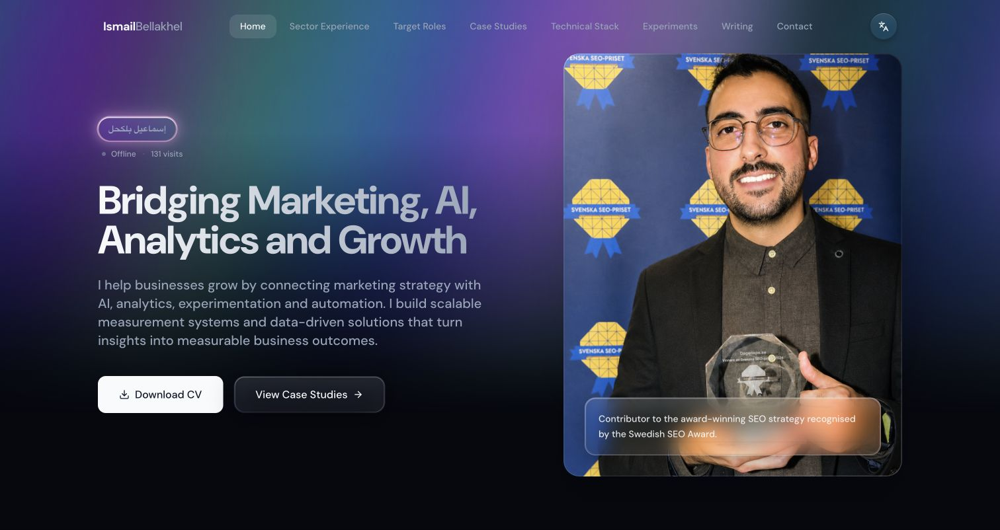

# Ismail Bellakhel — Personal Portfolio

**[Open the website →](https://ismailbellakhel.com/en)**

A personal website presenting my work across marketing, AI, analytics and growth.

## Explore the website

- Browse case studies and career achievements.
- Explore the technical stack, sector experience and target roles.
- Switch between English, Swedish, Norwegian and French.
- Download the CV or use the professional contact links.

## What this demonstrates

Professional positioning, clear case-study storytelling, multilingual content and responsive presentation. The website connects marketing strategy, measurement, experimentation and automation in one portfolio.

This is a presentation-only showcase. It includes the live website link and a screenshot, with no application source, backend files or implementation architecture. The existing portfolio source repository is managed separately; this showcase does not change that repository's visibility.
